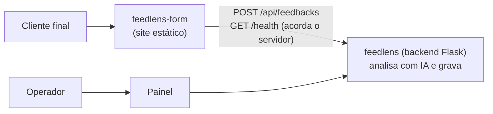

# FeedLens · formulário público

Front do **cliente final** do [FeedLens](https://github.com/IannCarvalho/feedlens): uma tela só, onde a pessoa escreve e envia um feedback. Não tem login, não mostra feedbacks de outras pessoas e não fala em termos técnicos. Quem opera o produto vê o resultado no painel: [feedlens-panel](https://github.com/IannCarvalho/feedlens-panel).

Angular 22 (zoneless, Signal Forms), TypeScript e Vitest.

## Como se encaixa



O formulário é um **site estático independente**. O backend não o serve, então o cookie de sessão do painel nunca chega a ele. Ele só conhece uma rota da API:

- `POST /api/feedbacks` com `{ "id": "<uuid>", "feedback": "<texto>" }`. O `id` é gerado no navegador e reaproveitado nas tentativas: reenviar é seguro, e um `409` conta como "já recebemos".
- `GET /health`, sem CORS (`no-cors`), só para acordar o servidor enquanto a pessoa escreve.

Limites do contrato: de 5 a 5000 caracteres (`MAX_FEEDBACK_CHARS` no backend). A API e o fluxo ponta a ponta estão no [README](https://github.com/IannCarvalho/feedlens/blob/main/README.md) e no [ARCHITECTURE.md](https://github.com/IannCarvalho/feedlens/blob/main/ARCHITECTURE.md) do backend.

## Configuração em tempo de execução

O app lê `config.json` ao subir (não entra no bundle), então o mesmo build serve qualquer ambiente:

| Campo | `config.json` do repositório | Se o arquivo faltar | Uso |
|---|---|---|---|
| `apiBaseUrl` | `http://127.0.0.1:5000` | `""` | Origem da API, sem barra final. Ex.: `https://api.exemplo.com` |
| `useMock` | `true` | `true` | `true` = modo demonstração, sem servidor. `false` = envia de verdade |
| `productName` | `o nosso produto` | `nosso produto` | Nome citado nos textos, na voz do cliente final |

O `productName` entra no meio de uma frase ("Sua opinião ajuda a melhorar *{productName}*"), então escreva-o com o artigo: `o Acme App`, `a loja Acme`.

Se o arquivo faltar ou falhar, o app cai no modo demonstração (segunda coluna) em vez de abrir em branco.

**Modo demonstração** (`useMock: true`, o padrão do repositório): nada é enviado ao servidor e nada aparece no painel. Um painel recolhido, que não existe com `useMock: false`, troca o cenário (envio normal, repetido, lento, muitos envios, instável, sem conexão, recusado) e mostra o corpo que seria enviado. Também dá para abrir `?cenario=sem-conexao` na URL.

## Rodando em desenvolvimento

Requer Node 24.15 ou superior (`.node-version`; com `fnm`, rode `fnm use`).

```powershell
npm ci
npm start            # http://127.0.0.1:4200 (modo demonstração, sem servidor)
npm run typecheck    # tipos, inclusive dos templates e dos testes
npm run lint
npm test             # Vitest
npm run build        # dist/feedback-form/browser (com orçamento de bundle)
```

Para enviar de verdade a um backend local:

1. Suba o backend em `http://127.0.0.1:5000`, com um provedor de IA configurado (veja o [README do backend](https://github.com/IannCarvalho/feedlens/blob/main/README.md)).
2. Em `public/config.json`, troque `"useMock": true` por `"useMock": false` (o `apiBaseUrl` do repositório já aponta para `http://127.0.0.1:5000`). **Não commite essa alteração**: o padrão do repositório precisa continuar `useMock: true`.
3. Rode `npm start` e envie um texto que pareça feedback sobre um produto ou serviço. Ele aparece em **Feedbacks** no painel.

Se o feedback não aparece no painel, as causas comuns são: o formulário ainda está em modo demonstração; a IA marcou o texto como spam (use o filtro de spam no painel); ou a IA não conseguiu analisar (o feedback fica com o selo "Não analisado").

## Docker

A imagem compila o app e o serve com nginx. A configuração entra por variáveis de ambiente, que o contêiner grava em `config.json` ao subir:

```powershell
docker build -t feedlens-form .
docker run --rm -p 8080:80 feedlens-form
```

Sem variáveis, a imagem sobe em modo demonstração em `http://localhost:8080`. Para enviar de verdade a uma API, passe as variáveis:

```powershell
docker run --rm -p 8080:80 -e USE_MOCK=false -e API_BASE_URL=https://api.exemplo.com -e "PRODUCT_NAME=o Acme App" feedlens-form
```

| Variável | Padrão | Observação |
|---|---|---|
| `USE_MOCK` | `true` | Só aceita `true` ou `false`; outro valor impede o contêiner de subir |
| `API_BASE_URL` | vazio | Origem da API, sem barra final. Com `USE_MOCK=false` e vazio, o envio vai para a própria origem do formulário e falha |
| `PRODUCT_NAME` | `o nosso produto` | Escreva com o artigo, como no `config.json` |

O nginx responde `200` em `/healthz`, serve o `index.html` para qualquer rota do app (reload em `/obrigado`, por exemplo) e nunca deixa o `config.json` em cache.

Sem Docker, qualquer hospedagem de arquivos estáticos serve (Vercel, Netlify, Render Static...): publique `dist/feedback-form/browser` e configure o fallback de rotas para o `index.html`.

### Configuração no deploy estático (Vercel etc.)

O `config.json` é um **asset** copiado de `public/` para o build. Como uma hospedagem estática **não** roda o entrypoint do contêiner, a configuração de runtime entra no momento do build: o hook `prebuild` (`scripts/gen-config.mjs`) gera o `public/config.json` a partir das **mesmas variáveis de ambiente** do caminho Docker. Basta defini-las no painel do provedor (o build é `npm run build`, a saída é `dist/feedback-form/browser`):

| Variável | Propósito | Exemplo |
|---|---|---|
| `API_BASE_URL` | Origem da API do backend, **sem barra final**. Vira `apiBaseUrl`. | `https://feedlens.onrender.com` |
| `USE_MOCK` | `false` = envia de verdade; `true` = modo demonstração. Só aceita `true`/`false`. Vira `useMock`. | `false` |
| `PRODUCT_NAME` | Nome citado nos textos, **com o artigo**. Vira `productName`. | `o FeedLens` |

Se **nenhuma** das três estiver definida, o `prebuild` não toca no `config.json` — então o `ng serve` de desenvolvimento e o build local continuam no `public/config.json` do repositório (modo demonstração). O caminho Docker é preservado: no estágio de build do contêiner essas variáveis não existem, e o entrypoint do nginx continua gravando o `config.json` a partir das env vars do runtime.

## Exigências do backend

- **CORS:** em produção, liste a origem do formulário em `CORS_ORIGINS` no backend (o padrão é `*`).
- **Chave de ingestão (`INGEST_API_KEY`):** um site público não guarda segredo. Se a chave estiver ligada no backend, o formulário recebe `401`. Para recebimento público, é preciso uma rota de ingestão sem segredo (origem permitida, limite próprio e teto de gasto). Isso é uma mudança de backend, fora deste front.

## Estrutura

```
public/config.json            apiBaseUrl, useMock, productName (lido em tempo de execução)
src/main.ts                   lê o config e sobe o app
src/app/app.config.ts         escolhe o gateway: mock ou HTTP
src/app/core/                 FeedbackGateway (contrato), HTTP, mock + dados, sessão de envio
src/app/features/send/        formulário (Signal Forms)
src/app/features/thanks/      confirmação (só abre depois de um envio)
src/app/features/demo/        painel do modo demonstração (não existe com useMock: false)
Dockerfile, docker/           imagem nginx e o script que grava o config.json
```

A tela só conhece `FeedbackGateway.send(id, texto)`, que devolve `ok` ou um motivo (`invalid`, `busy`, `offline`, `unavailable`). Status HTTP e formato da API ficam dentro de `http-feedback.gateway.ts`.

## Contrato com a API

O contrato é pequeno e vive em `http-feedback.gateway.ts` (`classify` traduz o status HTTP para a linguagem da tela). Uma mudança no `POST /api/feedbacks` do backend exige um PR aqui. Um contrato formal (OpenAPI) é uma etapa futura da migração.

## Histórico

Este repositório nasceu da pasta `feedback-form/` do [feedlens](https://github.com/IannCarvalho/feedlens), com o histórico de git preservado (`git filter-repo`). Referências como `IannCarvalho/feedlens#43` nas mensagens de commit apontam para PRs do repositório original.

## Licença

[MIT](LICENSE)
